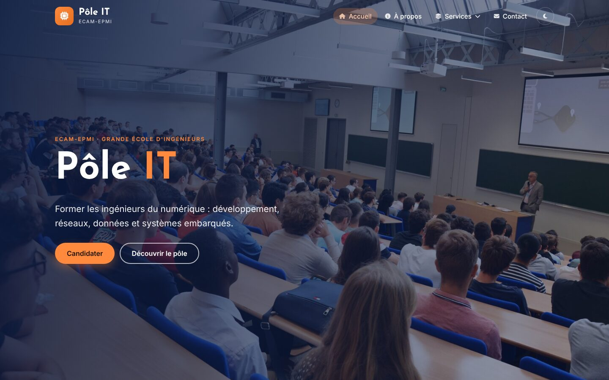
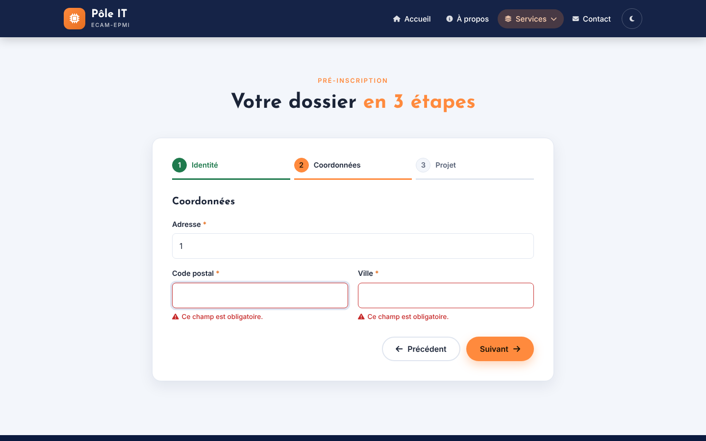
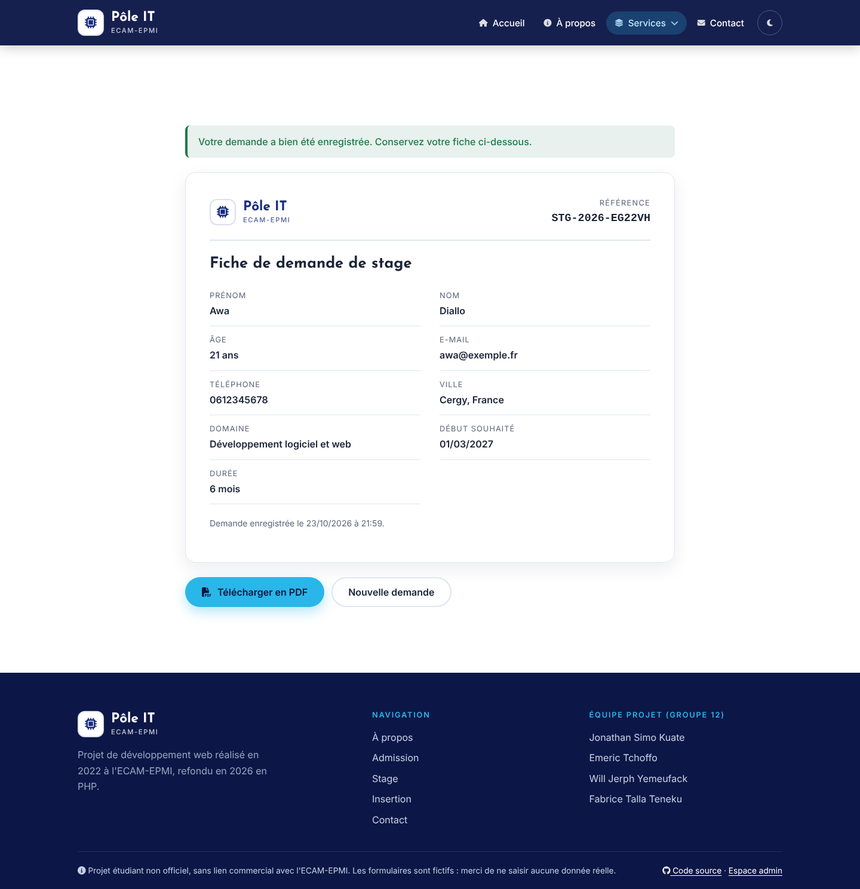
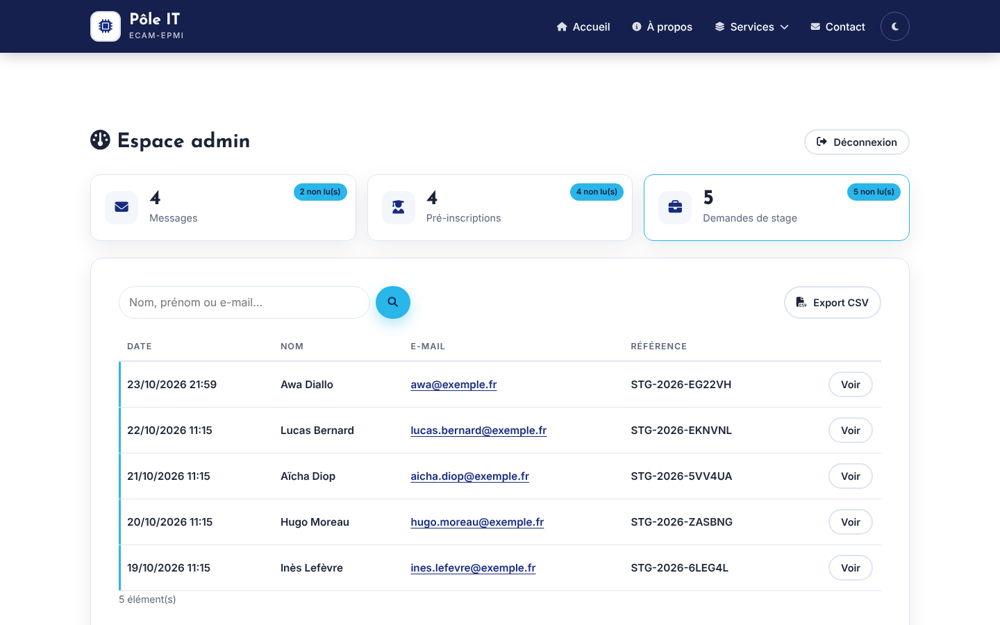
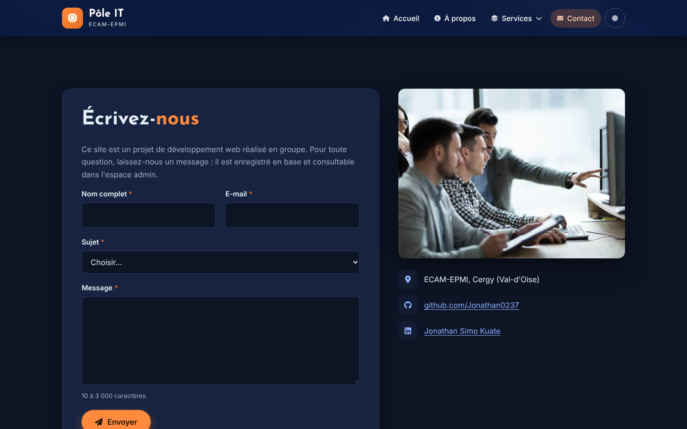
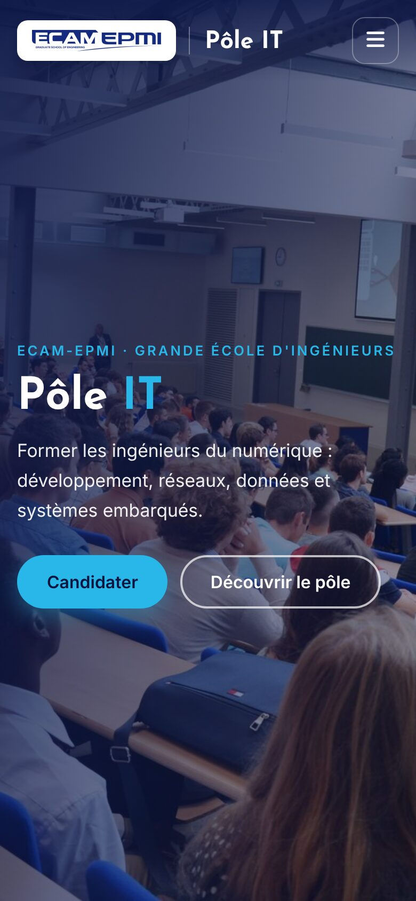
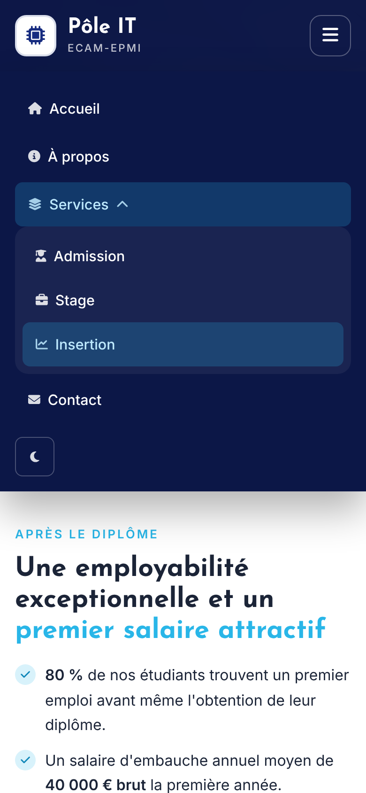
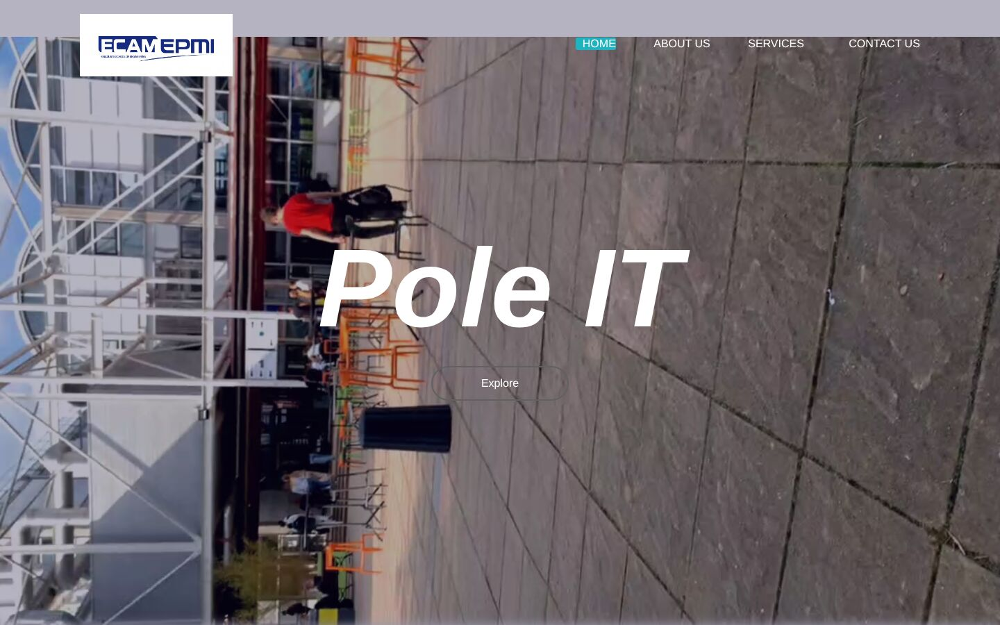
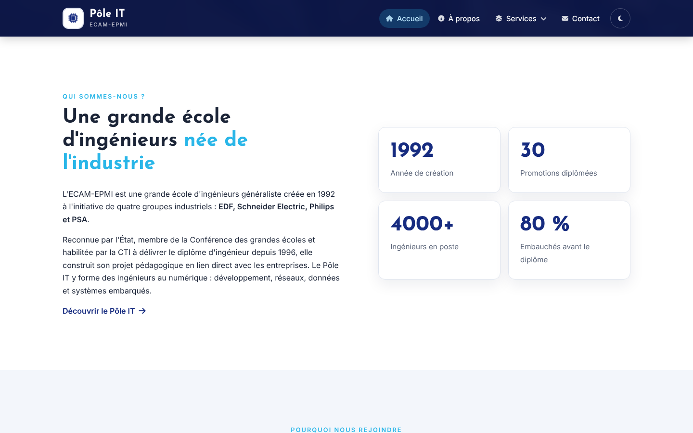

<div align="center">

# Pôle IT · ECAM-EPMI

**Site vitrine et formulaires en ligne pour le Pôle IT d'une école d'ingénieurs, développés en PHP 8 natif, sans framework.**

[](https://github.com/Jonathan0237/pole-it-ecam/actions/workflows/ci.yml)


**[Voir la démo en ligne](https://pole-it-ecam.onrender.com)** · espace admin : `demo` / `demo`



</div>

> [!NOTE]
> Projet étudiant **non officiel**, réalisé en groupe à l'ECAM-EPMI en 2022, puis refondu en 2026. Il n'a aucun lien commercial avec l'école et les formulaires sont fictifs.

## Sommaire

- [Le projet](#le-projet)
- [Fonctionnalités](#fonctionnalités)
- [Captures](#captures)
- [Démarrer en local](#démarrer-en-local)
- [Architecture](#architecture)
- [Sécurité](#sécurité)
- [Qualité et tests](#qualité-et-tests)
- [Déploiement](#déploiement)
- [Avant / après](#avant--après)
- [Équipe](#équipe)

## Le projet

En première année du cycle ingénieur, notre groupe devait concevoir un site de présentation pour le Pôle IT de l'école en HTML, CSS et JavaScript. La version d'origine (2022) comportait six pages, un carrousel, un formulaire d'admission en plusieurs étapes et une fiche de stage exportée en PDF côté navigateur.

En 2026, j'ai repris ce projet pour en faire une **application web complète** :

| Besoin | Version 2022 | Version 2026 |
| --- | --- | --- |
| Gabarit commun | HTML copié dans chaque page | Gabarit PHP unique et vues |
| Formulaires | Aucun traitement, ou service tiers | Traitement serveur, validation, base SQLite |
| Données saisies | Perdues | Stockées et consultables dans un espace admin |
| Sécurité | Injection HTML possible, RIB demandé | Échappement systématique, CSRF, anti-spam, données minimales |
| Responsive | Partiel | Pensé mobile d'abord, menu burger |
| Accessibilité | Aucune | Labels, erreurs reliées aux champs, navigation clavier, contrastes |
| Thème | Clair | Clair et sombre, avec mémorisation du choix |
| Médias | 15 Mo (vidéos filmées à la verticale) | 2 Mo d'images optimisées |
| Déploiement | Fichiers à ouvrir dans le navigateur | Docker, CI GitHub Actions, déploiement Render |

## Fonctionnalités

**Site public**
- 6 pages : accueil, à propos, admission, stage, insertion, contact.
- Carrousel accessible (boutons, puces, glissement au doigt, pause au survol, respect de `prefers-reduced-motion`).
- Compteurs animés et apparition progressive des sections au défilement.
- Thème clair ou sombre, automatique ou choisi par l'utilisateur.

**Formulaires (PHP)**
- **Contact** : message enregistré en base.
- **Pré-inscription** : formulaire en 3 étapes avec validation à chaque étape. En cas d'erreur, le serveur renvoie directement sur l'étape fautive, et le formulaire reste utilisable sans JavaScript.
- **Demande de stage** : génère une référence unique (`STG-2026-XXXXXX`) et une **fiche récapitulative imprimable en PDF**, visible uniquement par son auteur et par l'administrateur.

**Espace admin** (`/admin`)
- Connexion protégée contre la force brute (blocage après 5 essais).
- Tableau de bord : compteurs, éléments non lus, recherche, pagination.
- Fiche détaillée, réponse par e-mail, suppression, **export CSV** compatible Excel.

## Captures

| Pré-inscription en 3 étapes | Fiche de stage |
| --- | --- |
|  |  |

| Espace admin | Thème sombre |
| --- | --- |
|  |  |

| Mobile | Menu mobile |
| --- | --- |
|  |  |

## Démarrer en local

**Avec PHP 8.2 ou plus** (extension `pdo_sqlite`) :

```bash
git clone https://github.com/Jonathan0237/pole-it-ecam.git
cd pole-it-ecam
php bin/seed.php                                  # données de démonstration (facultatif)
php -S localhost:8000 -t public router.php
```

**Avec Docker** :

```bash
docker compose up --build
```

Le site est alors disponible sur http://localhost:8000 (ou http://localhost:8080 avec Docker). Pour l'espace admin en mode démo, l'identifiant est `demo` et le mot de passe `demo`.

### Configuration

| Variable | Rôle | Valeur par défaut |
| --- | --- | --- |
| `DEMO_MODE` | Active le compte `demo` et les données fictives au démarrage | `true` |
| `ADMIN_USER` | Identifiant administrateur | `demo` |
| `ADMIN_PASSWORD_HASH` | Hash du mot de passe (`php -r 'echo password_hash("…", PASSWORD_DEFAULT);'`). Désactive le compte démo | vide |
| `DATA_DIR` / `DB_PATH` | Emplacement de la base SQLite | `data/pole-it.sqlite` |

## Architecture

```
pole-it-ecam/
├── public/                 # Racine web : seuls ces fichiers sont accessibles
│   ├── index.php, a-propos.php, admission.php, stage.php, insertion.php, contact.php
│   ├── stage-fiche.php     # Fiche récapitulative imprimable
│   ├── admin/              # Connexion, tableau de bord, détail, suppression, export CSV
│   └── assets/             # CSS, JS, images, Font Awesome auto-hébergé
├── src/
│   ├── bootstrap.php       # Configuration, session sécurisée, en-têtes HTTP, autoload
│   ├── Database.php        # Connexion PDO SQLite et création du schéma
│   ├── Repository.php      # Requêtes préparées, recherche, pagination
│   ├── Forms.php           # Règles métier des 3 formulaires
│   ├── Validator.php       # Validation serveur réutilisable (API fluide)
│   ├── Csrf.php, FormGuard.php, Auth.php
│   └── views/              # Gabarit commun et vues
├── tests/                  # 24 tests unitaires, sans dépendance
├── bin/seed.php            # Données de démonstration
├── Dockerfile, docker-compose.yml, render.yaml
└── .github/workflows/ci.yml
```

**Choix techniques**
- **PHP natif, sans framework ni Composer**, pour montrer la maîtrise des bases : cycle requête/réponse, sessions, PDO, pattern Post/Redirect/Get.
- **SQLite** : aucune base à installer, un seul fichier, suffisant pour ce volume de données.
- **JavaScript vanilla** en amélioration progressive : chaque formulaire fonctionne aussi sans JS.
- **CSS sans framework** : variables CSS, Grid et Flexbox, thème sombre via `prefers-color-scheme`.

## Sécurité

| Risque | Protection |
| --- | --- |
| Injection SQL | Requêtes préparées PDO, liste blanche des tables et colonnes |
| XSS | Échappement systématique (`e()`), Content-Security-Policy stricte sans script inline |
| CSRF | Jeton de session vérifié avec `hash_equals` sur chaque POST |
| Spam | Champ piège (honeypot) et délai minimal entre deux envois |
| Force brute | Blocage de la connexion admin pendant 5 minutes après 5 échecs |
| Vol de session | Cookie `HttpOnly`, `SameSite=Lax`, `Secure` en HTTPS, régénération de l'identifiant à la connexion |
| Injection CSV | Cellules commençant par `= + - @` neutralisées à l'export |
| Fuite de données | Base hors de la racine web, fiche de stage visible par son seul auteur, aucune donnée bancaire demandée |

## Qualité et tests

```bash
php tests/run.php
```

Les 24 tests couvrent la validation, les règles des formulaires, l'accès aux données (pagination, recherche, injections) et les protections de sécurité. À chaque push, la CI GitHub Actions :
1. vérifie la syntaxe de tous les fichiers PHP (versions 8.2 et 8.3) ;
2. lance les tests unitaires ;
3. démarre le serveur et contrôle les codes HTTP de chaque page, ainsi que l'absence d'avertissement PHP ;
4. construit l'image Docker et vérifie qu'elle répond.

## Déploiement

Le dépôt contient un `render.yaml` : sur [Render](https://render.com), choisir **New > Blueprint**, puis sélectionner ce dépôt. L'image Docker s'adapte au port imposé par l'hébergeur et charge des données de démonstration au premier démarrage.

Démo actuelle : https://pole-it-ecam.onrender.com. Sur l'offre gratuite, le service se met en veille : le premier chargement peut prendre une trentaine de secondes, et la base est réinitialisée à chaque redéploiement.

## Avant / après

| 2022 | 2026 |
| --- | --- |
|  |  |

## Équipe

Projet du groupe 12, ECAM-EPMI (2022-2023) :
- **Jonathan Simo Kuate** (auteur de la refonte PHP de 2026)
- Emeric Tchoffo
- Will Jerph Yemeufack
- Fabrice Talla Teneku

Le logo et les photos appartiennent à l'ECAM-EPMI et sont utilisés dans un cadre pédagogique. Les icônes viennent de [Font Awesome Free](https://fontawesome.com) (licence CC BY 4.0 / SIL OFL / MIT).
